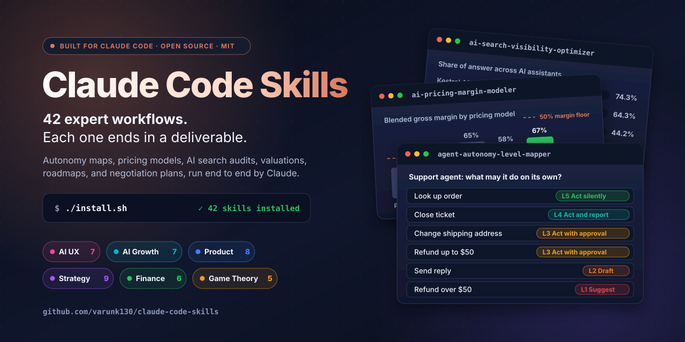
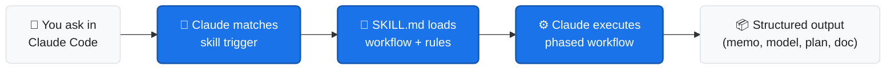
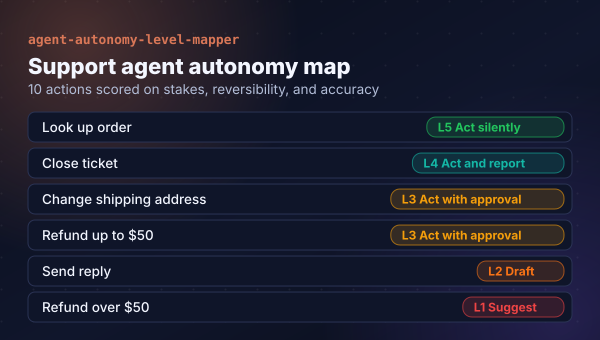
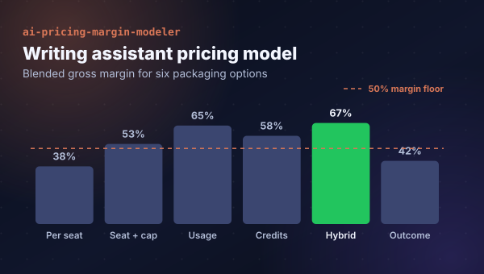
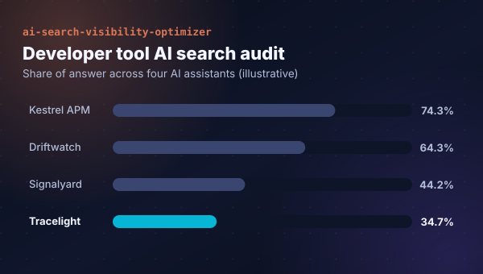

<div align="center">



# 🧰 Claude Code Custom Skills

### 42 production-grade Claude Code skills for AI UX, AI marketing and growth, product, strategy, finance, and game theory.

[](#-skill-categories)
[](#-skill-categories)
[](LICENSE)
[](https://claude.ai/code)

**Maintained by [Varun Kulkarni](https://github.com/varunk130)**

</div>

**Expert frameworks, packaged as Claude Code skills.** Ask for a discounted cash flow model, an autonomy map for your AI agent, or a pricing model that accounts for inference cost, and Claude follows a practitioner-grade workflow to a deliverable you can hand to a stakeholder, instead of improvising a generic answer.

```bash
git clone https://github.com/varunk130/claude-code-skills.git && cd claude-code-skills && ./install.sh
```

**Why this library**

- **Built for AI products.** Dedicated categories for designing UX for AI agents and for marketing, pricing, and growing AI products, alongside classic finance, product, and strategy frameworks.
- **Every skill ends in a deliverable.** A scored audit, a model, a memo, or a plan, never a list of tips.
- **One standard format.** Every skill has the same sections, explicit triggers, and Always / Never operating rules, so they are easy to learn and extend.
- **Validated in CI.** A format check and an installer smoke test run on every change.

---

## Table of Contents

- [What is a skill?](#what-is-a-skill)
- [How it works](#how-it-works)
- [Quickstart](#-quickstart)
- [See it in action](#-see-it-in-action)
- [Find the right skill](#-find-the-right-skill)
- [Skill categories](#-skill-categories)
  - [AI UX & Design](#ai-ux--design-7-skills)
  - [AI Marketing & Growth](#ai-marketing--growth-7-skills)
  - [Financial Analysis](#financial-analysis-6-skills)
  - [Product Management](#product-management-8-skills)
  - [Strategic Management](#strategic-management-9-skills)
  - [Game Theory](#game-theory-5-skills)
- [Pairs well with](#pairs-well-with)
- [Standard skill format](#standard-skill-format)
- [Authoring a new skill](#authoring-a-new-skill)
- [Contributing](#contributing)
- [Related work](#related-work)
- [License](#license)

---

## What is a skill?

A **skill** is a single markdown file (`SKILL.md`) that gives Claude Code domain-specific knowledge, a structured workflow, and clear output expectations. Put the skill's folder in `~/.claude/skills/` (so the file sits at `~/.claude/skills/<skill-name>/SKILL.md`) and Claude loads it on demand, either when you type its slash command or when your request matches its description.

Every skill in this repository follows the **same standard format** (see [Standard skill format](#standard-skill-format)) so they're easy to learn, easy to compose, and easy to extend.

## How it works



---

## ⚡ Quickstart

```bash
git clone https://github.com/varunk130/claude-code-skills.git
cd claude-code-skills
./install.sh            # installs every skill into ~/.claude/skills
```

Restart Claude Code, then invoke any skill by name or just describe the task:

```text
/dcf-valuation-builder
/opportunity-solution-tree
"Map the competitive response if we cut prices 20%"
```

**Install only some categories:**

```bash
./install.sh --list                          # see categories and skills
./install.sh financial-analysis game-theory  # install just these
```

**Project-local install** (skills available only in one project): run `./install.sh --project` from that project's root, using the full path to the script.

**Manual install:** Claude Code looks for skills exactly one level deep (`~/.claude/skills/<skill-name>/SKILL.md`), so copy the skill folders, not the category folders:

```bash
mkdir -p ~/.claude/skills
for d in skills/*/*/; do cp -R "${d%/}" ~/.claude/skills/; done
```

> 💡 New to Claude Code skills? See the [official skills guide](https://docs.anthropic.com/en/docs/claude-code/skills) for installation locations and discovery rules.

---

## 👀 See it in action

Worked examples show exactly what a skill produces, with every number computed the way the skill specifies:

<p align="center">
  <a href="examples/agent-autonomy-level-mapper-support-agent.md"></a>
  <a href="examples/ai-pricing-margin-modeler-writing-assistant.md"></a>
  <a href="examples/ai-search-visibility-optimizer-devtool.md"></a>
</p>

| Example | Skill | What you get |
|---------|-------|--------------|
| [Support agent autonomy map](examples/agent-autonomy-level-mapper-support-agent.md) | agent-autonomy-level-mapper | 10 support actions scored on stakes, reversibility, and measured accuracy, each assigned an autonomy level with approval gates |
| [Writing assistant pricing model](examples/ai-pricing-margin-modeler-writing-assistant.md) | ai-pricing-margin-modeler | Cost per successful task, heavy-user exposure, and six packaging options compared at median and tail usage |
| [Developer tool AI search audit](examples/ai-search-visibility-optimizer-devtool.md) | ai-search-visibility-optimizer | Share of answer across four AI assistants, citation-source gaps, and a prioritized fix backlog |

More in [examples/](examples/).

---

## 🔎 Find the right skill

| If you want to... | Start with |
|-------------------|------------|
| Decide what an AI agent may do without asking | [agent-autonomy-level-mapper](skills/ai-ux-design/agent-autonomy-level-mapper/SKILL.md) |
| Review an AI feature before launch | [ai-ux-audit](skills/ai-ux-design/ai-ux-audit/SKILL.md) |
| Design what users see when the AI is wrong, slow, or unsure | [ai-failure-state-designer](skills/ai-ux-design/ai-failure-state-designer/SKILL.md) |
| Show up in ChatGPT, Claude, Perplexity, and AI Overviews answers | [ai-search-visibility-optimizer](skills/ai-marketing-growth/ai-search-visibility-optimizer/SKILL.md) |
| Answer "why not just use a general-purpose assistant?" | [ai-product-positioning](skills/ai-marketing-growth/ai-product-positioning/SKILL.md) |
| Price an AI product without losing money on heavy users | [ai-pricing-margin-modeler](skills/ai-marketing-growth/ai-pricing-margin-modeler/SKILL.md) |
| A/B test a feature whose output varies run to run | [ai-feature-experiment-designer](skills/ai-marketing-growth/ai-feature-experiment-designer/SKILL.md) |
| Turn interview notes into themes and opportunities | [customer-interview-synthesizer](skills/product-management/customer-interview-synthesizer/SKILL.md) |
| Prioritize a roadmap with more than one framework | [product-roadmap-prioritizer](skills/product-management/product-roadmap-prioritizer/SKILL.md) |
| Value a company or business unit | [dcf-valuation-builder](skills/financial-analysis/dcf-valuation-builder/SKILL.md) |
| Plan cash and runway | [burn-rate-runway-planner](skills/financial-analysis/burn-rate-runway-planner/SKILL.md) |
| Predict how a competitor will react to your move | [competitive-response-modeler](skills/game-theory/competitive-response-modeler/SKILL.md) |
| Prepare for a negotiation | [negotiation-strategist](skills/game-theory/negotiation-strategist/SKILL.md) |

---

## 📂 Skill categories

Skills are organized into six categories. Each category folder has its own README with the full skill index and design principles.

| Category | Skills | What it's for |
|----------|-------:|---------------|
| [🤖 AI UX & Design](skills/ai-ux-design/) | 7 | Agent autonomy, human-in-the-loop, failure states, uncertainty, prompt surfaces, usability testing for AI |
| [📈 AI Marketing & Growth](skills/ai-marketing-growth/) | 7 | AI search visibility, positioning, launches, experiments, activation, content quality, inference-aware pricing |
| [💰 Financial Analysis](skills/financial-analysis/) | 6 | Valuation, capital allocation, SaaS economics, cash management, fundamental analysis |
| [📦 Product Management](skills/product-management/) | 8 | Discovery, prioritization, customer research, strategic decisions, communication |
| [🧭 Strategic Management](skills/strategic-management/) | 9 | Industry analysis, positioning, landscape mapping, OKRs, go-to-market |
| [♟️ Game Theory](skills/game-theory/) | 5 | Equilibrium analysis, negotiation, competitive dynamics, mechanism design |

### AI UX & Design (7 skills)

> Design the experience of AI products and agents: how much they do on their own, where humans step in, how they fail, and how they show uncertainty. - [Category README](skills/ai-ux-design/README.md)

| Skill | What it produces |
|-------|------------------|
| [agent-autonomy-level-mapper](skills/ai-ux-design/agent-autonomy-level-mapper/SKILL.md) | Per-action autonomy map (suggest / draft / act-with-approval / act-and-report / act-silently) from a stakes x reversibility x confidence score, with approval-gate spec and promotion criteria |
| [ai-failure-state-designer](skills/ai-ux-design/ai-failure-state-designer/SKILL.md) | Failure-mode inventory mapped to User Interface (UI) patterns, recovery actions, latency treatments, and microcopy library |
| [ai-usability-test-planner](skills/ai-ux-design/ai-usability-test-planner/SKILL.md) | Usability study plan for non-deterministic features: Wizard-of-Oz and seeded-output tasks, variance-aware metrics, trust-calibration measures, offline evaluation pairing |
| [ai-ux-audit](skills/ai-ux-design/ai-ux-audit/SKILL.md) | Stakes-weighted heuristic scorecard across six AI dimensions with stress-scenario evidence and severity-ranked fix list |
| [human-in-the-loop-designer](skills/ai-ux-design/human-in-the-loop-designer/SKILL.md) | Human-in-the-loop (HITL) touchpoint design: checkpoints, approval gates, escalation triggers, handoff packages, interruption-cost scoring, and review-fatigue limits |
| [prompt-surface-designer](skills/ai-ux-design/prompt-surface-designer/SKILL.md) | Chat and agent input experience: capability inventory, blank-box risk score, scored starter prompts, input affordances, follow-ups, and first-run onboarding |
| [uncertainty-and-explainability-patterns](skills/ai-ux-design/uncertainty-and-explainability-patterns/SKILL.md) | Confidence, citation, and reasoning pattern spec matched to audience and risk, with calibration checks and anti-pattern review |

### AI Marketing & Growth (7 skills)

> Market, launch, price, and grow AI products, and keep AI-assisted marketing honest. - [Category README](skills/ai-marketing-growth/README.md)

| Skill | What it produces |
|-------|------------------|
| [ai-activation-optimizer](skills/ai-marketing-growth/ai-activation-optimizer/SKILL.md) | Retention-validated aha moment, time to first good output, quality-aware activation funnel, first-session scaffolding, and quality-gated nudges |
| [ai-content-quality-gate](skills/ai-marketing-growth/ai-content-quality-gate/SKILL.md) | Publish / revise / kill verdict for AI-assisted content with claim verification log, added-value score, AI-tell list, and brand-voice scorecard |
| [ai-feature-experiment-designer](skills/ai-marketing-growth/ai-feature-experiment-designer/SKILL.md) | A/B test design for AI features with offline evaluation gate, variance-aware sample size, cost / latency / override guardrails, and pre-registered decision rules |
| [ai-launch-playbook](skills/ai-marketing-growth/ai-launch-playbook/SKILL.md) | AI launch plan with readiness gates, demo-led narrative, capacity-sized waitlist, channel plan, day-0 to day-30 runbook, and failure-mode communications |
| [ai-pricing-margin-modeler](skills/ai-marketing-growth/ai-pricing-margin-modeler/SKILL.md) | Cost per successful task, usage distribution, gross-margin floor, packaging margin comparison at median, 90th, and 99th percentile usage, and price-change guardrails |
| [ai-product-positioning](skills/ai-marketing-growth/ai-product-positioning/SKILL.md) | Scored differentiation ladder (model, data, workflow, distribution, trust), answers to the general-assistant, wrapper, and fast-follow objections, and messaging hierarchy |
| [ai-search-visibility-optimizer](skills/ai-marketing-growth/ai-search-visibility-optimizer/SKILL.md) | Generative Engine Optimization (GEO) audit with intent-weighted query set, share-of-answer scores, citation-source gap map, entity fixes, and re-test plan |

### Financial Analysis (6 skills)

> Rigorous, defensible financial modeling and analysis. Outputs survive an investment committee or board grilling. — [Category README](skills/financial-analysis/README.md)

| Skill | What it produces |
|-------|------------------|
| [ai-agent-financial-analyst](skills/financial-analysis/ai-agent-financial-analyst/SKILL.md) | Software as a Service (SaaS) financial models: unit economics, feature Return on Investment (ROI), pricing scenarios, market sizing, build versus buy, and revenue projections with sensitivity ranges |
| [burn-rate-runway-planner](skills/financial-analysis/burn-rate-runway-planner/SKILL.md) | Burn decomposition, scenario plans, lever stack, 13-week cash forecast, fundraise trigger calendar |
| [capital-allocation-framework](skills/financial-analysis/capital-allocation-framework/SKILL.md) | Ranked investment portfolio across Net Present Value (NPV), Internal Rate of Return (IRR), Profitability Index (PI), and Equivalent Annual Annuity (EAA) plus strategic option value and risk-adjusted frontier |
| [dcf-valuation-builder](skills/financial-analysis/dcf-valuation-builder/SKILL.md) | Full Discounted Cash Flow (DCF) with WACC build, two terminal-value methods reconciled, sensitivity table, football field |
| [financial-statement-analyzer](skills/financial-analysis/financial-statement-analyzer/SKILL.md) | Form 10-K and Form 10-Q teardown with margin waterfall, quality-of-earnings score, accounting red-flag log |
| [saas-cohort-analyzer](skills/financial-analysis/saas-cohort-analyzer/SKILL.md) | Cohort retention triangles, Net Revenue Retention (NRR) / Gross Revenue Retention (GRR), Lifetime Value (LTV), Customer Acquisition Cost (CAC) payback, movement bridge, segmentation cuts |

### Product Management (8 skills)

> Skills for the modern product manager and product trio: continuous discovery, multi-framework prioritization, customer research synthesis. — [Category README](skills/product-management/README.md)

| Skill | What it produces |
|-------|------------------|
| [ai-decision-engine](skills/product-management/ai-decision-engine/SKILL.md) | Multi-framework strategic recommendations from full project context (Product Requirements Documents (PRDs), research, metrics, competitive intel) |
| [ai-product-strategy](skills/product-management/ai-product-strategy/SKILL.md) | AI opportunity map with build / buy / partner calls, data moat rating, trust requirements, phased roadmap, and risk register |
| [ai-stakeholder-translator](skills/product-management/ai-stakeholder-translator/SKILL.md) | 5 audience-tailored communications (engineering, executives, board, customers, sales) from one product update |
| [customer-interview-synthesizer](skills/product-management/customer-interview-synthesizer/SKILL.md) | Coded transcripts, themes, Jobs-to-be-Done (JTBD) signals, forces of progress, opportunity hypotheses |
| [jobs-to-be-done-extractor](skills/product-management/jobs-to-be-done-extractor/SKILL.md) | Functional / emotional / social job statements, job map, outcome scoring, hire / fire analysis |
| [opportunity-solution-tree](skills/product-management/opportunity-solution-tree/SKILL.md) | Outcome → opportunities → solutions → assumption tests, as a living tree |
| [product-discovery-coach](skills/product-management/product-discovery-coach/SKILL.md) | Continuous discovery practice: weekly trio cadence, assumption mapping, discovery / delivery dual track |
| [product-roadmap-prioritizer](skills/product-management/product-roadmap-prioritizer/SKILL.md) | Reach-Impact-Confidence-Effort (RICE) plus Kano plus Must-Should-Could-Won't (MoSCoW) plus Cost of Delay scoring with convergence analysis and quarterly roadmap |

### Strategic Management (9 skills)

> Classical and modern strategy frameworks executed with rigor. — [Category README](skills/strategic-management/README.md)

| Skill | What it produces |
|-------|------------------|
| [blue-ocean-strategy-canvas](skills/strategic-management/blue-ocean-strategy-canvas/SKILL.md) | As-is and to-be value curves, Eliminate-Reduce-Raise-Create (ERRC) grid, non-customer analysis, buyer utility map, sequence test |
| [go-to-market-strategy](skills/strategic-management/go-to-market-strategy/SKILL.md) | Complete go-to-market plan: prioritized segments, channels with owners, messaging matrix, launch timeline, 30/60/90-day success metrics |
| [gtm-engineering](skills/strategic-management/gtm-engineering/SKILL.md) | Go-to-market data infrastructure: lead scoring, routing, lifecycle automation, attribution, reverse Extract-Transform-Load (ETL) sync contracts |
| [market-sizing](skills/strategic-management/market-sizing/SKILL.md) | Total Addressable Market (TAM), Serviceable Addressable Market (SAM), and Serviceable Obtainable Market (SOM), triangulated across top-down and bottom-up methods with an assumption log |
| [okr-cascade-planner](skills/strategic-management/okr-cascade-planner/SKILL.md) | Company → function → team Objectives and Key Results (OKRs) cascade with alignment map and quarterly rituals |
| [porters-five-forces-analyzer](skills/strategic-management/porters-five-forces-analyzer/SKILL.md) | Five Forces scorecard with dominant force, trajectory, and strategic moves per force |
| [pricing-strategy-analyzer](skills/strategic-management/pricing-strategy-analyzer/SKILL.md) | Pricing recommendation from competitive positioning, value metric fit, willingness-to-pay evidence, packaging, revenue scenarios, and a migration plan |
| [strategic-landscape-mapper](skills/strategic-management/strategic-landscape-mapper/SKILL.md) | User-need value chain on a maturity axis with environmental forces, operating principles, and strategic plays |
| [swot-tows-analyzer](skills/strategic-management/swot-tows-analyzer/SKILL.md) | Evidence-anchored SWOT plus TOWS matrix producing prioritized strategic options |

### Game Theory (5 skills)

> Apply game theory to real decisions: pricing wars, negotiation, mechanism design, repeated interactions. — [Category README](skills/game-theory/README.md)

| Skill | What it produces |
|-------|------------------|
| [competitive-response-modeler](skills/game-theory/competitive-response-modeler/SKILL.md) | Multi-round action-reaction tree with reaction functions, commitment moves, and signaling analysis |
| [mechanism-design-planner](skills/game-theory/mechanism-design-planner/SKILL.md) | Mechanism design for auctions, matching, and pricing with Incentive Compatibility (IC), Individual Rationality (IR), revenue equivalence, and collusion stress tests |
| [nash-equilibrium-solver](skills/game-theory/nash-equilibrium-solver/SKILL.md) | Pure and mixed Nash equilibria, dominance, subgame perfection, and equilibrium selection |
| [negotiation-strategist](skills/game-theory/negotiation-strategist/SKILL.md) | Best Alternative to a Negotiated Agreement (BATNA), Zone of Possible Agreement (ZOPA), multi-issue trade matrix, anchoring plan, concession schedule, tactical playbook |
| [repeated-game-strategist](skills/game-theory/repeated-game-strategist/SKILL.md) | Critical discount factor, strategy selection (Tit-for-Tat, grim trigger, Pavlov), reputation, and retaliation policy |

---

## Pairs well with

This library focuses on business decision-making. For file formats and tool integrations, install the official skills from their maintainers:

- [anthropics/skills](https://github.com/anthropics/skills) - Anthropic's skills for Word, PowerPoint, Excel, PDF, skill authoring, and more
- [Claude Code plugins](https://docs.anthropic.com/en/docs/claude-code/plugins) - install vendor plugins such as Figma, Notion, and Stripe, which bundle their own skills

---

## Standard skill format

Every custom skill in this repository follows the same structure so they are easy to learn, compose, and extend:

```markdown
---
name: <skill-name>
description: "<What the skill produces.> Use when <trigger 1>; <trigger 2>; <trigger 3>."
---

# <Skill Title>

> <One-line tagline / positioning statement.>

## What this skill is
<2–3 sentences describing the skill's role and approach.>

## What it solves
- <Pain 1>
- <Pain 2>
- <Pain 3>

## When to invoke
- <Trigger 1>
- <Trigger 2>
- <Trigger 3>

## Phase 1: ...
## Phase 2: ...
...

## Output
<Bullet list of deliverables produced.>

## Operating rules
**Always:** ...
**Never:** ...
```

Skills also follow two writing conventions: **acronyms are spelled out on first use** with the abbreviation in parentheses, and content uses **professional, neutral vocabulary** that travels well across organizations.

---

## Authoring a new skill

See [docs/SKILL_TEMPLATE.md](docs/SKILL_TEMPLATE.md) for the full template, field-by-field guidance, length targets, and the quality checklist.

Quick checklist:
- Single `SKILL.md` per skill, placed in the right category folder
- Frontmatter with `name` and `description`
- Description includes explicit "Use when…" triggers
- Follows the [Standard skill format](#standard-skill-format) above
- Acronyms spelled out on first use
- `python3 scripts/validate_skills.py` passes (CI runs it on every pull request)

---

## Contributing

Pull requests welcome. Please keep:
- One skill per pull request for easier review
- Skill placed in the correct category folder
- Format consistent with the standard above
- Description includes the trigger phrases people would actually type

See [CONTRIBUTING.md](CONTRIBUTING.md) for full guidelines and [CODE_OF_CONDUCT.md](CODE_OF_CONDUCT.md).

For security issues, see [SECURITY.md](SECURITY.md).

---

## Related work

Part of a portfolio of AI agent and skill libraries for product, GTM, and decision-making teams.

**Discovery & research**

- [ai-customer-discovery-skills](https://github.com/varunk130/ai-customer-discovery-skills) — Turn raw customer signal into validated product opportunities (5 of 12 shipped)
- [jtbd-extractor](https://github.com/varunk130/ai-customer-discovery-skills/tree/main/skills/jtbd-extractor) — Extract Jobs-to-be-Done statements from research, with opportunity scoring

**Strategy & decisions**

- [AI-Builder-Decision-Analyst](https://github.com/varunk130/AI-Builder-Decision-Analyst) — 11 skills that catch bad bets before you ship across DECIDE / BUILD / COMMUNICATE / LEARN

**Go-to-market**

- [ai-gtm-skill-library](https://github.com/varunk130/ai-gtm-skill-library) — 37 opinionated GTM skills across the full discover → renew lifecycle
- [ai-marketing-claude-skills](https://github.com/varunk130/ai-marketing-claude-skills) — 12 marketing-ops skills with scoring algorithms and statistical frameworks
- [ai-marketing-os](https://github.com/varunk130/ai-marketing-os) — Run a marketing org as an orchestrated AI team: 9 agents, 12 expert skills, end-to-end missions that ship real artifacts
- [ai-partner-ecosystem-analysis](https://github.com/varunk130/ai-partner-ecosystem-analysis) — Deep research on any ISV, partner, or competitor with a 1-slide PPTX output

**UX & design**

- [ai-ux-skill-library](https://github.com/varunk130/ai-ux-skill-library) — 13 frameworks for designing UX for AI products, agents, and AI-powered experiences

**Multi-agent demos**

- [ai-pm-agents-suite](https://github.com/varunk130/ai-pm-agents-suite) — 6-agent pipeline plus 3 standalone PM agents (decision engine, financial analyst, stakeholder translator) that turn customer feedback into strategy, PRDs, and comms
- [ai-legal-agents-skills-os](https://github.com/varunk130/ai-legal-agents-skills-os) — Agentic operating system for legal work: one master agent, nine specialist skills, MCP + MCP Apps
- [ai-growth-os](https://github.com/varunk130/ai-growth-os) — Compound: a multi-agent growth experiment engine that runs the find → design → ship → learn loop end-to-end, offline
- [ai-customer-acquisition](https://github.com/varunk130/ai-customer-acquisition) — Beacon: five agents allocate a budget across channels, build the creative, and reallocate on week-1 results
- [ai-revops](https://github.com/varunk130/ai-revops) — Atlas: nine agents across GTM, Partnerships, and RevOps take a company into a new market with one Vertical Launch Plan

**Evaluation & operations**

- [AI-Eval-Skills](https://github.com/varunk130/AI-Eval-Skills) — 7 skills to plan, generate, run, interpret, and triage AI agent evaluations
- [ai-workflow-playbooks](https://github.com/varunk130/ai-workflow-playbooks) — 21 playbooks + 10 skills + 4 guardians + 5 runbooks across the 7-stage delivery pipeline

---

## License

[MIT](LICENSE)

---

<div align="center">

<sub>Built by <a href="https://github.com/varunk130">Varun Kulkarni</a> — part of a portfolio of AI agent systems for product, finance, and strategy teams.</sub>

</div>
