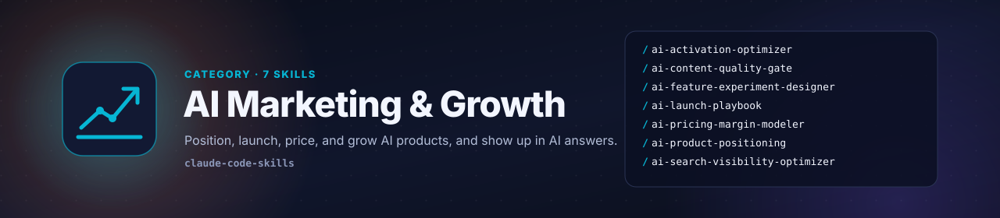

# AI Marketing & Growth Skills

Marketing and growth workflows built for Artificial Intelligence (AI) products and AI-era channels: visibility in AI assistant answers, positioning against general-purpose assistants, launches, experimentation on non-deterministic features, activation, content quality, and inference-aware pricing.

| Skill | What it produces |
|-------|------------------|
| [ai-activation-optimizer](ai-activation-optimizer/SKILL.md) | Retention-validated aha moment, time to first good output, quality-aware activation funnel, first-session scaffolding, and quality-gated nudges |
| [ai-content-quality-gate](ai-content-quality-gate/SKILL.md) | Publish / revise / kill verdict for AI-assisted content with claim verification log, added-value score, AI-tell list, and brand-voice scorecard |
| [ai-feature-experiment-designer](ai-feature-experiment-designer/SKILL.md) | A/B test design for AI features with offline evaluation gate, variance-aware sample size, cost / latency / override guardrails, and pre-registered decision rules |
| [ai-launch-playbook](ai-launch-playbook/SKILL.md) | AI launch plan with readiness gates, demo-led narrative, capacity-sized waitlist, channel plan, day-0 to day-30 runbook, and failure-mode communications |
| [ai-pricing-margin-modeler](ai-pricing-margin-modeler/SKILL.md) | Cost per successful task, usage distribution, gross-margin floor, packaging margin comparison at median, 90th, and 99th percentile usage, and price-change guardrails |
| [ai-product-positioning](ai-product-positioning/SKILL.md) | Scored differentiation ladder (model, data, workflow, distribution, trust), answers to the general-assistant, wrapper, and fast-follow objections, and messaging hierarchy |
| [ai-search-visibility-optimizer](ai-search-visibility-optimizer/SKILL.md) | Generative Engine Optimization (GEO) audit with intent-weighted query set, share-of-answer scores, citation-source gap map, entity fixes, and re-test plan |

## Who these are for

Founders, product marketers, growth leads, Product Managers (PMs), and go-to-market leaders building, launching, or scaling AI products, and marketing teams adapting to AI-generated answers and AI-assisted content production.

## Design principles

- **Quality is part of the funnel** - every metric accounts for whether the AI output was actually good
- **Measure what varies** - non-deterministic outputs need repeated runs, variance-aware samples, and distributions, not single anecdotes
- **Unit economics are visible** - inference cost per task sits next to growth metrics
- **Defensible against the default** - every claim holds up when the buyer can try a general-purpose assistant instead
- **Honest by design** - no fabricated proof, no manipulation of AI engines, and stated limits
